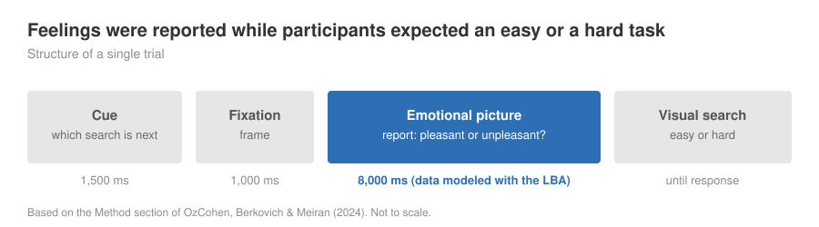

<div align="center">

# Bumpy Ride Ahead: Anticipated Effort as Emotional Evidence?

**Data and R code for the paper by Elad OzCohen, Rotem Berkovich and Nachshon Meiran**

*Cognitive, Affective, & Behavioral Neuroscience* (2024), 24, 681–693

[](https://doi.org/10.3758/s13415-024-01194-9)
[](https://osf.io/hq8k9)
[](https://doi.org/10.3758/s13415-024-01194-9)


</div>

---

## The question

When we expect a demanding task, do we also feel worse? And can that expectation count as *evidence* that a feeling is unpleasant?

In this preregistered experiment, 70 students reported whether emotional pictures felt pleasant or unpleasant. Each report was embedded in a period in which the participant expected either an easy visual search (a single feature) or a hard one (a conjunction of features). The reports and reaction times were then fitted with a hierarchical Bayesian **Linear Ballistic Accumulator (LBA)**, a model in which evidence for "pleasant" and "unpleasant" accumulates in a race until one wins.

<p align="center">
  
</p>

## Main finding

Anticipated effort was associated with a **higher rate of unpleasant evidence accumulation, but only for normatively unpleasant pictures**, and not for normatively pleasant ones. The authors read this as anticipated effort being one possible source of emotional evidence, under a certain interpretation of the findings. Full results, caveats and the non-preregistered analyses are in the [paper](https://doi.org/10.3758/s13415-024-01194-9).

## Study at a glance

| | |
|---|---|
| **Participants** | 70 students; 6 excluded for responding counter-normatively in more than half of the trials |
| **Stimuli** | 240 emotional pictures from the NAPS database (half negative, half positive) |
| **Design** | 2 (picture valence) × 2 (visual-search difficulty), within subjects |
| **Structure** | 4 blocks of 60 trials, after a 30-trial practice phase |
| **Model** | Hierarchical Bayesian LBA fitted with `ggdmc` (MCMC), compared with a null model |
| **Inference** | Bayesian ANOVAs (BANOVA) on the estimated drift rates |

## Repository structure

```
Emotional_Evidence_Paper/
├── Raw_Data/
│   ├── sub_set1.xlsx … sub_set8.xlsx       trial-level behavioral data, split into 8 subsets
│   ├── Behavioral_Analysis_Code.Rmd        response rates, reaction times, manipulation check
│   └── Balanced_Emo_Pictures_Analysis.Rmd  analysis of the balanced stimulus subset
├── LBA_with_B_and_DR/                      core model: boundary and drift rate
│   ├── Ballistic_Code_2505.R               model fitting script
│   ├── GelmanRubin_DR_all.csv              convergence diagnostics
│   └── summary_DR_all.csv                  posterior parameter summaries
├── LBA_Null_Model/                         null model: no effect of valence or anticipated effort
└── LBA_For_Balanced_Emo_Stimuli/           core model on the balanced stimulus subset
```

## Reproducing the analysis

1. Install R and the packages used by the scripts, among them `tidyverse`, `readxl`, `ggdmc`, `rtdists`, `lme4`, `afex`, `emmeans`, `effectsize` and `apaTables`.
2. Open the script you want to run and **update the file paths** at the top. The scripts were written on the author's machine and read the data from absolute paths such as `D:/OneDrive/...`; point them to the `Raw_Data` folder of this repository.
3. Fitting hierarchical Bayesian models with MCMC is computationally heavy. The posterior summaries and Gelman-Rubin diagnostics are included, so the results can be inspected without refitting.

## Citation

> OzCohen, E., Berkovich, R., & Meiran, N. (2024). Bumpy ride ahead: Anticipated effort as emotional evidence? *Cognitive, Affective, & Behavioral Neuroscience, 24*, 681–693. https://doi.org/10.3758/s13415-024-01194-9

```bibtex
@article{ozcohen2024bumpy,
  title   = {Bumpy ride ahead: Anticipated effort as emotional evidence?},
  author  = {OzCohen, Elad and Berkovich, Rotem and Meiran, Nachshon},
  journal = {Cognitive, Affective, \& Behavioral Neuroscience},
  volume  = {24},
  pages   = {681--693},
  year    = {2024},
  doi     = {10.3758/s13415-024-01194-9}
}
```

## Links

- Paper (open access): <https://doi.org/10.3758/s13415-024-01194-9>
- Preregistration and OSF repository: <https://osf.io/hq8k9>

## Acknowledgements

Department of Psychology and Zelman Center of Neuroscience, Ben-Gurion University of the Negev. Supported by Grant #1547/20 from the Israel Science Foundation to N. Meiran.
